# Orbit TV

An Android TV app for browsing and watching the NASA video library with a D-pad remote. It is
built entirely with Jetpack Compose for TV and a multi-module, clean architecture.

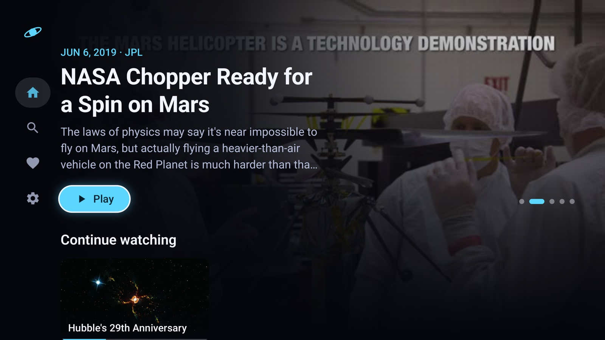

## Features

- **Home**: a hero carousel of featured videos, then rows for *Continue watching*, *Your
  favorites* and topics (Apollo, Mars, …). Each row remembers its focused card.
- **Details**: title, date, center, keywords and description, with Play / Resume, a favorite
  toggle and *More like this*.
- **Player**: Media3 ExoPlayer with a custom TV control overlay.
  - ±10 s seeking on the D-pad, plus media keys (play, pause, fast-forward, rewind).
  - Resumes where you left off, and an *Up next* countdown at the end of a video.
  - Falls back to a lower-quality stream when one fails.
- **Search**: results appear as you type (debounced) in a paged grid. Suggestions show while the
  field is empty.
- **Favorites**: a grid with an edit mode for removing videos. Focus moves to the card that takes
  a removed card's place.
- **Settings**: an autoplay toggle, clearing watch history (with confirmation) and an About panel.
- **Navigation drawer**: a collapsed icon rail that expands while focused. Each screen keeps its
  query, scroll position and focus when you switch away and back.

## Screenshots

| | |
|---|---|
| 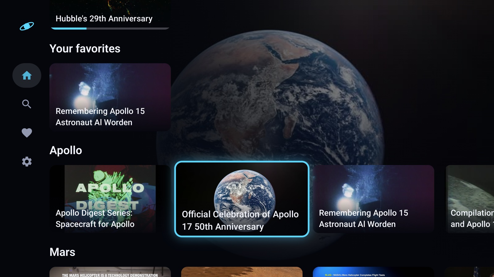 | 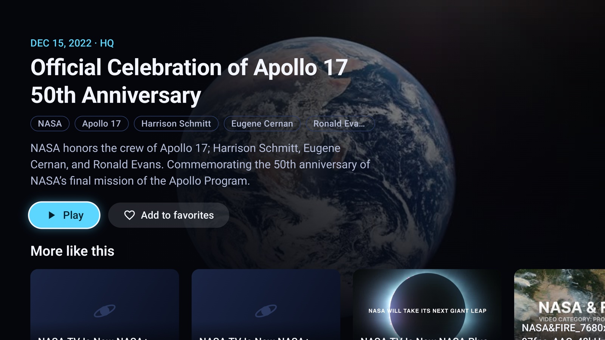 |
| Home: content rows, focused card | Details |
| 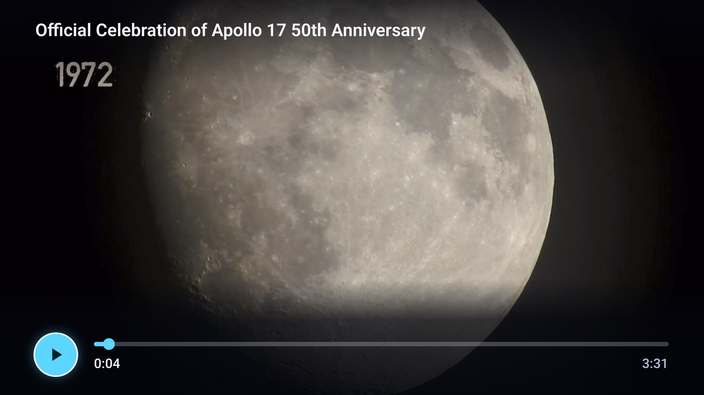 | 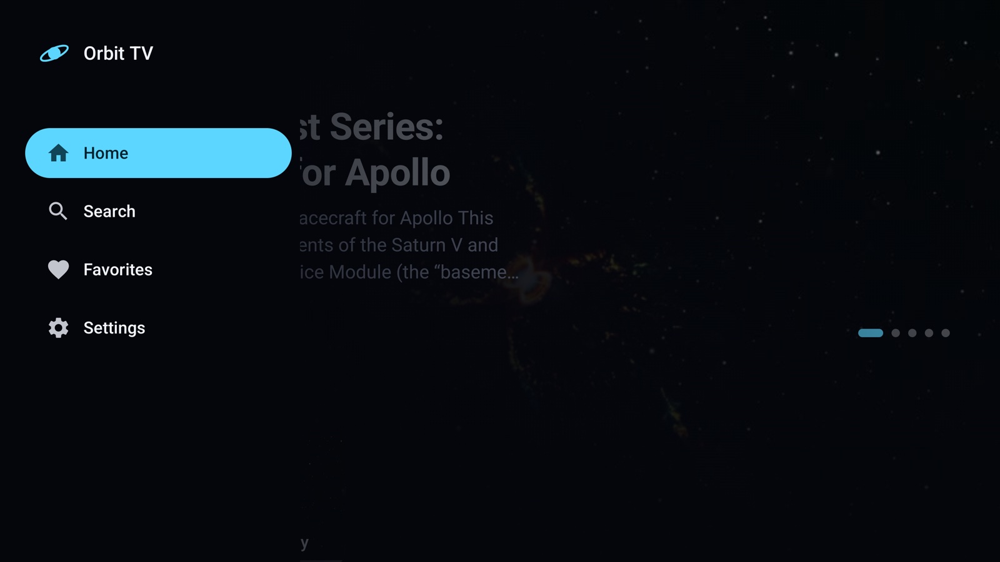 |
| Player controls | Navigation drawer |
| 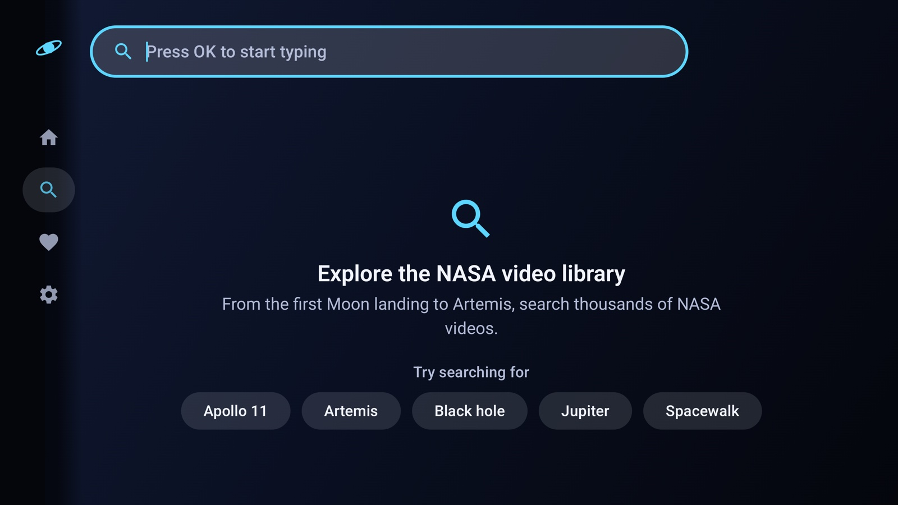 | 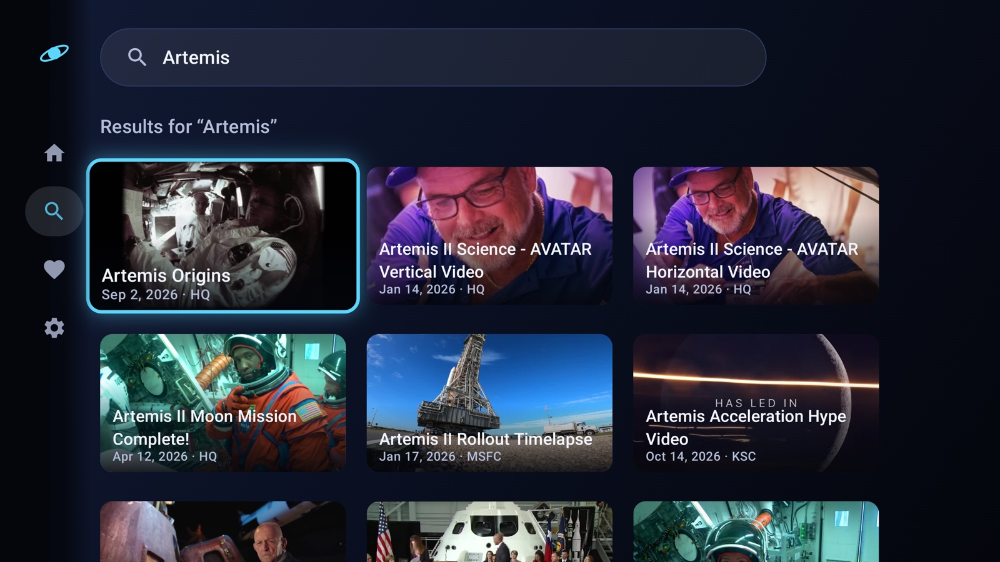 |
| Search: suggestions | Search: paged results |
| 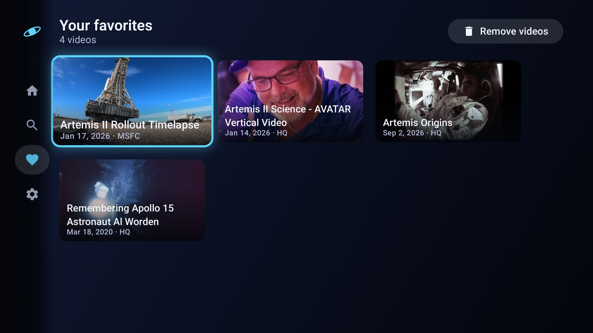 | 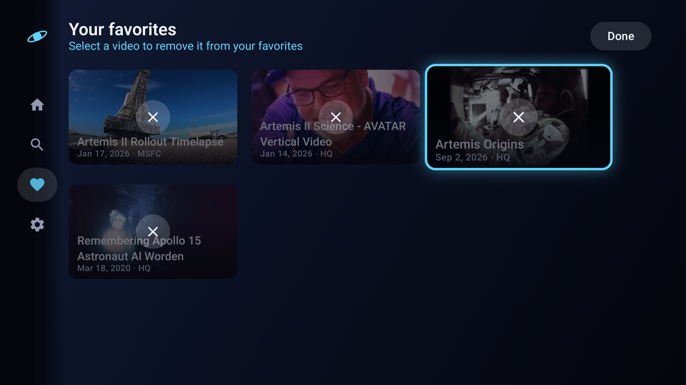 |
| Favorites | Favorites: edit mode |
| 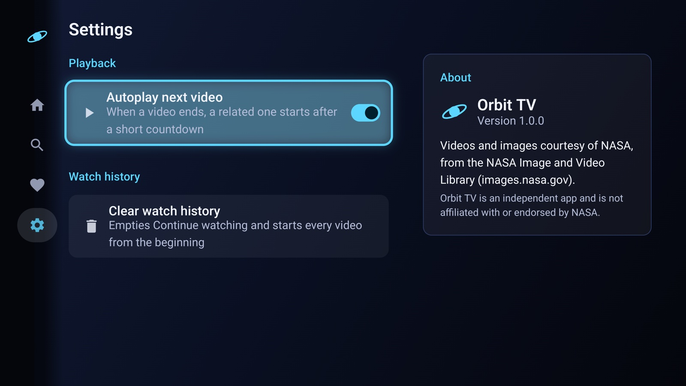 | 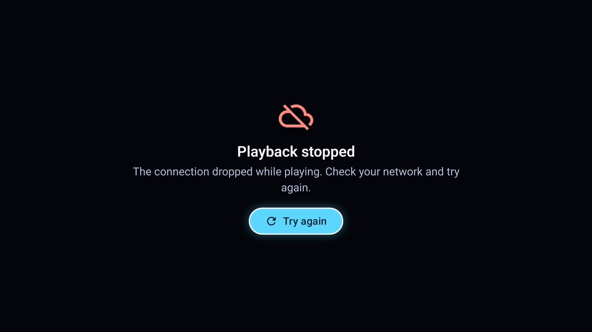 |
| Settings | Error state with retry |

## Built for the 10-foot experience

- **Predictable focus.** The first launch focuses the hero. Returning from Details restores the
  card you left, and every row and grid remembers its position. There are no focus traps, and the
  drawer is always one press of Left away.
- **Visible from across the room.** Focused cards scale up with an accent border and glow.
  Typography is sized for TV, and all content stays inside the overscan safe area.
- **Remote-friendly input.** Back works everywhere: it hides player controls, leaves edit mode and
  returns to the hero before exiting. The search keyboard opens only on OK, so Up and Down always
  move between the field and the results.
- **Resilient to a messy API.** Malformed search items are skipped individually. `http://` asset
  URLs with raw spaces are normalized, HTML is stripped from descriptions, and videos with no
  playable file never crash the app.

## Architecture

MVVM with unidirectional data flow. Each screen has one `@HiltViewModel` that exposes a single
immutable `StateFlow<UiState>` plus a `Flow` of one-off events. Screens are split into a stateful
`Route` and a stateless, previewable and testable `Screen`.

```
app ─────────────► feature:* ─────────► domain ◄──────── core:network
 (nav host,         (home, details,      (use cases,       (Retrofit, DTOs,
  drawer, DI root)   player, search,      repository        paging)
                     favorites,           interfaces)
                     settings)              ▲             core:database
                        │                   └────────────  (Room, DataStore)
                        ▼
                 core:designsystem          core:model, core:common
                 (theme, TV components,     (pure Kotlin models,
                  focus helpers)             Outcome/DataError, qualifiers)
```

- **Dependency inversion.** Repository interfaces live in `domain`. Their implementations live in
  `core:network` and `core:database` and are bound with Hilt. DTOs and Room entities never leave
  their module.
- **Feature isolation.** Feature modules depend only on `domain`, `core:model`, `core:common` and
  `core:designsystem`, never on each other or on the data layer. Navigation between them is wired
  in `app`.
- **Pure Kotlin core.** `core:model`, `core:common` and `domain` have no Android dependencies.
- **Errors as values.** Repositories return `Outcome<T>` (`Success` / `Failure(DataError)`) and
  never throw. The UI maps each `DataError` to a friendly message with a retry action.
- **Offline-friendly local data.** Favorites and playback progress reference a shared snapshot
  table of videos, so those lists render without the network.
- **Convention plugins.** `build-logic` holds them (`orbit.android.feature`, `orbit.jvm.library`,
  …), which keeps every module build file a few lines long. All versions live in
  `gradle/libs.versions.toml`.

## Tech stack

| Area | Libraries |
|---|---|
| UI | Jetpack Compose, Compose for TV (`androidx.tv:tv-material`), Navigation Compose, Coil 3 |
| Playback | Media3 ExoPlayer (custom Compose UI, no `PlayerView` controls) |
| DI | Hilt (KSP) |
| Network | Retrofit, OkHttp, kotlinx.serialization |
| Data | Room, DataStore Preferences, Paging 3 |
| Async | Coroutines, Flow |
| Quality | Android lint (warnings as errors), detekt, ktlint with Compose rules, GitHub Actions CI |
| Testing | JUnit 4, Truth, Turbine, kotlinx-coroutines-test, Robolectric, Compose UI test, MockWebServer |

Built with AGP 9 (with its built-in Kotlin support) and Kotlin 2.4. The minimum SDK is 28 and the
target SDK is 37.

## Testing

The suite has 179 host tests and needs no device:

- **Use cases and ViewModels** run against hand-written fakes (no mocking library), with Turbine
  for flows.
- **Network** tests use MockWebServer with JSON fixtures recorded from the real NASA API,
  including its quirks.
- **Room and DataStore** run on Robolectric.
- **Compose UI and focus tests** also run on Robolectric. They cover D-pad navigation, focus
  restoration after navigating back, the drawer, the player overlay and the edit mode.

CI runs ktlint, detekt, lint, the unit tests and a debug build on every push.

## Getting started

Requirements: a recent stable Android Studio, JDK 17 or newer, and an Android TV emulator or
device (API 28+). The NASA Image and Video Library API needs no key.

```bash
./gradlew assembleDebug          # build
./gradlew test                   # all unit and UI tests (Robolectric)
./gradlew :app:lintDebug         # Android lint
./gradlew detekt ktlintCheck     # static analysis and formatting
```

Install `app/build/outputs/apk/debug/app-debug.apk` on a TV emulator, or run the `app`
configuration from Android Studio.

## Roadmap

- [x] Project setup, build logic, design system, CI
- [x] Network, database, domain and repositories
- [x] Home and Details with focus handling
- [x] Player with progress saving and media keys
- [x] Search, Favorites, Settings, navigation drawer
- [ ] Watch Next integration and deep links
- [ ] Baseline profile and final polish

## Credits

Videos and images are courtesy of NASA, from the
[NASA Image and Video Library](https://images.nasa.gov). Orbit TV is an independent portfolio
project and is not affiliated with or endorsed by NASA.
